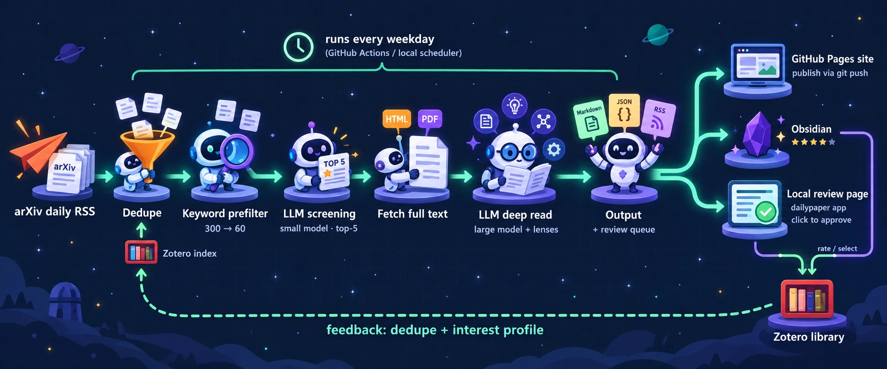

# DailyPaper

[](https://github.com/YuanChangYe/DailyPaper/actions/workflows/ci.yml)

> An automated arXiv reading assistant: it fetches new papers every day, screens them with an LLM against your research topics, and writes structured deep-reading notes focused on **insight and novelty**. Output goes to a static website, Obsidian, and (after your review) Zotero. Fully configurable and plugin-based.

DailyPaper 每天自动抓取 arXiv 新论文，用大语言模型按你设定的研究方向筛选，再对最相关的几篇做全文精读，生成一份能在 10 分钟内读完、围绕 **insight 与 novelty** 展开的阅读笔记。

- **不用自己搭服务器**：GitHub Actions 每天定时运行，GitHub Pages 免费托管网站。
- **一份 Markdown，多处使用**：同一批文件既是网站内容，也可以直接放进 Obsidian。
- **入库前先审核**：精读结果先进入审核页，你点击确认后才写入 Zotero。
- **全部可配置**：研究方向、模型、精读框架、流水线步骤都由配置文件决定；新增功能只需写一个插件。

> [!NOTE]
> 笔记由 LLM 生成，可能有误读或遗漏。它的定位是帮你判断"值不值得读、该读哪里"，不能替代阅读原文。

---

## 目录

- [效果示例](#效果示例)
- [工作流程](#工作流程)
- [快速开始](#快速开始)
- [部署：每天自动运行](#部署每天自动运行)
- [配置你的研究方向](#配置你的研究方向)
- [精读框架与 lens](#精读框架与-lens)
- [网页](#网页)
- [Zotero 联动与审核页](#zotero-联动与审核页)
- [Obsidian](#obsidian)
- [网站与站点接口](#网站与站点接口)
- [模型与费用](#模型与费用)
- [代码结构](#代码结构)
- [扩展开发](#扩展开发)
- [命令参考](#命令参考)
- [隐私与安全](#隐私与安全)
- [常见问题](#常见问题)
- [路线图](#路线图)

---

## 效果示例

每篇精读笔记都按同一个框架输出，完整示例见 [examples/paper-note.md](examples/paper-note.md)。下面摘录其中几段：

> **Core insight**：策略干预只改变 X 的边缘分布而不改变 P(Y|X) → 联合似然比只依赖 X，可以用无标签的 source/target 协变量学出 → 校准误差由 ratio 的 TV/L1 误差直接决定，预测器无需重训。
>
> **Novelty delta**：（与 4–5 篇最相近前作的对比表）……判断：偏增量。主要贡献是整合与干净的误差传递……
>
> **Red flags**：校准与评估都从同一个 192 点的样本池中抽样……没有真实的策略切换……
>
> **Research hooks**：① 自我改进 agent 的门控 ratio 重校准……（改变的假设 → 最小验证实验 → 风险）

此外还会生成每日日报、按研究方向整理的索引页、JSON 数据和 RSS。

---

## 工作流程

<p align="center">
  
</p>

```
                ┌──── 定时触发：GitHub Actions 或本地任务计划（每个工作日） ────┐
                │                                                                │
 arXiv 每日 RSS ─▶ 去重 ─▶ 关键词预筛 ─▶ LLM 摘要筛选 ─▶ 全文获取 ─▶ LLM 精读 ─▶ 输出
                    ▲        几百→几十      小模型打分      HTML/PDF     大模型+lens    │
                    │                        top-k                                     │
        Zotero 文库索引 / 兴趣画像                                      Markdown · JSON · RSS
        （跳过已有论文，按相似度调序）                                   + 审核队列
                    ▲                                                               │
                    │                              ┌─────────────────────┬──────────┴──────────┐
                    │                              ▼                     ▼                     ▼
                    │                      GitHub Pages 网站      Obsidian vault        本地审核页
                    │                      （git push 后发布）    （直接写入或 Git 拉取）  dailypaper app
                    │                                                    │                     │
                    │                                           评分 / 勾选入库          点击确认
                    │                                                    └──────────┬──────────┘
                    └───────────────────────────────────────────────────────────────┘
                                              写入 Zotero，回流去重与排序
```

| 步骤 | 做什么 | 费用 |
|---|---|---|
| 抓取 | 读取 arXiv 每日公告 RSS，一次请求拿到当天所有新论文 | 免费 |
| 去重 | 跳过处理过的论文，以及 Zotero 文库中已有的论文 | 免费 |
| 关键词预筛 | 本地正则匹配，把几百篇缩到几十篇 | 免费 |
| LLM 筛选 | 小模型读标题和摘要，按研究方向打分，判断论文类型和新颖程度 | 很低 |
| 全文获取 | 优先用 arXiv HTML（保留章节和公式），其次 PDF，最后只用摘要 | 免费 |
| 精读 | 大模型按固定框架写笔记，并按论文自动叠加分析指引（lens） | 主要开销 |
| 输出 | 单篇笔记、日报、方向索引、首页、JSON API、RSS，并加入审核队列 | 免费 |

---

## 快速开始

需要 Python 3.10 或以上版本。

```bash
git clone https://github.com/YuanChangYe/DailyPaper.git
cd DailyPaper
python -m venv .venv
# Windows: .venv\Scripts\activate    macOS / Linux: source .venv/bin/activate
pip install -e ".[all]"
```

**不需要 API key 也能先体验**：用内置的离线假模型跑一遍完整流程（真实抓取 arXiv，但不调用付费模型）：

```bash
dailypaper run --provider fake --dry-run
mkdocs serve          # 浏览器打开 http://127.0.0.1:8000 预览网站
```

**使用真实模型**：把 `.env.example` 复制为 `.env`，填入 API key（`.env` 已在 `.gitignore` 中，不会被提交）：

```
ANTHROPIC_API_KEY=sk-ant-...
```

然后：

```bash
dailypaper read 2610.35877    # 先精读一篇指定论文，看看效果
dailypaper run                # 运行完整的每日流程
```

结果默认写在项目目录的 `docs/` 和 `data/` 下。个人使用时建议在 `.env` 中设置一个输出目录，让笔记、状态和缓存都放在项目之外，不会混进 git：

```
DAILYPAPER_WORKSPACE=D:/DailyPaperData
```

`dailypaper check` 会显示当前的输出位置。

---

## 部署：每天自动运行

有两种方式，按需选择。

### 方式 A：在自己的电脑上定时运行（推荐个人使用）

笔记只留在本地（以及你的 Obsidian 和 Zotero），不经过任何服务器。电脑在运行时刻没开机的话，开机后会自动补跑。

**Windows**：运行一次下面的命令，即可在任务计划程序中注册每天 14:00 的任务（当前用户，不需要管理员权限）：

```powershell
powershell -ExecutionPolicy Bypass -File scripts\install_task.ps1 -Time 14:00
```

日志在项目目录的 `logs/` 下，保留 30 天。取消任务：`scripts\uninstall_task.ps1`。

**macOS / Linux**：用 cron 调用同样的命令，例如 `0 14 * * 1-5 cd /path/to/DailyPaper && .venv/bin/dailypaper run >> logs/daily.log 2>&1`。

### 方式 B：在 GitHub Actions 上运行并发布网站

适合想要一个公开的论文日报网站的情况。整套流程运行在 GitHub 上，不需要自己的服务器；每日任务会把生成的笔记提交回仓库，所以请使用你自己的仓库（fork 或复制一份）。

1. **Fork 本仓库**，并在 **Actions** 标签页启用工作流（fork 默认禁用）。
2. **添加 API key**：**Settings → Secrets and variables → Actions → Secrets → New repository secret**，名称填 `ANTHROPIC_API_KEY`。如果用其他模型，就添加对应的名称，见[模型与费用](#模型与费用)。
3. **开启定时**：同一页面的 **Variables** 中添加 `DAILYPAPER_SCHEDULE`，值填 `true`。不添加时只能手动触发，不会自动运行。
4. **开启网站**：**Settings → Pages → Build and deployment → Source** 选择 **GitHub Actions**。页面上推荐的 Jekyll / Static HTML 模板不要点，仓库里已经有自己的发布流程。
5. **试运行**：**Actions → daily → Run workflow**。工作流会先做自检，缺少 Secret 等问题会直接显示在页面的 Annotations 中。之后每个工作日 UTC 06:00 自动运行，时间可以在 `.github/workflows/daily.yml` 中修改。
6. **填写网站地址**：网站发布在 `https://<用户名>.github.io/<仓库名>/`。把它填进 `config/settings.yaml` 的 `site.base_url`，RSS 中的链接就会指向网站。

> [!IMPORTANT]
> 这种方式下生成的笔记会提交到你的仓库。仓库公开时，笔记也是公开的；详见[隐私与安全](#隐私与安全)。

---

## 配置你的研究方向

所有配置都在 `config/` 目录下，通常只需要改这里，不用改代码。

| 文件 | 用途 |
|---|---|
| `topics.yaml` | **研究方向**：描述、关键词、权重、精读时追问的问题 |
| `pipeline.yaml` | 流水线步骤；每天精读几篇（`top_k`）、精读阈值（`min_score`）、arXiv 分类 |
| `llm.yaml` | 每个环节用哪个模型；价格表；月度预算 |
| `lenses.yaml` | 精读时可叠加哪些分析指引，以及什么时候使用 |
| `settings.yaml` | 输出语言、网站、Zotero、Obsidian、本地审核页 |

仓库自带的 `topics.yaml` 是一份示例，关注 LLM / Agent 的不确定性量化、基于 conformal prediction 的 selective prediction、agent 自我改进、multi-agent 可信性。换成你自己的方向时，每个方向这样写：

```yaml
topics:
  - id: conformal_selective                     # 唯一标识
    name: Selective Prediction via Conformal Prediction
    weight: 1.3                                 # 排序权重，1.0 为基准
    description: >                              # 给 LLM 看的方向描述，写得越具体，筛选越准
      基于 conformal prediction / risk control 的选择性预测与弃权……
    keywords: [conformal, risk control, selective prediction, abstention]   # 命中任意一个即可
    context: []                                 # 非空时还需同时命中其中一个（用于排除同名概念）
    exclude: []                                 # 命中则排除
    lens_questions:                             # 精读这个方向的论文时，额外追问的问题
      - 保证的形式是 marginal coverage、conditional coverage 还是 risk control？
      - exchangeability 假设在该场景下是否成立？
```

关键词不区分大小写，空格也能匹配连字符，`*` 是通配符（例如 `calibrat*`）。

YAML 中可以用 `${ENV}` 或 `${ENV:-默认值}` 引用环境变量。API key 只从环境变量读取，不要写进配置文件。

---

## 精读框架与 lens

精读 prompt 由两部分组成：**base 框架**决定笔记的结构；**lens** 根据论文自动叠加分析要点。

### base 框架

模板在 `prompts/base/deep_read.system.md.j2`，每篇笔记固定输出 10 节：

| 节 | 内容 |
|---|---|
| 0. TL;DR | 做了什么、最重要的结果（带数字）、对哪个方向有用 |
| 1. Problem formulation | 形式化设定、访问假设（black / grey / white-box）、数据假设、不确定性的粒度 |
| 2. Core insight | 用"现有方法默认 X → 实际上 Y → 所以作者做了 Z"概括 |
| 3. Novelty delta | 与最相近前作的对比表，判断是实质创新还是增量改进 |
| 4. Mechanism | 步骤拆解、关键公式、每个组件为什么有效 |
| 5. Guarantees & assumptions | 理论保证的类型、成立前提、在多步或多 agent 场景下是否会失效 |
| 6. Claim ↔ Evidence | 主要结论与实验证据的对照表，以及证据强度 |
| 7. Red flags | 作者没有充分讨论的问题，区分"作者已承认"和"〔分析〕" |
| 8. Research hooks | 2–3 条可以接着做的研究想法：改变了哪个假设、最小验证实验、主要风险 |
| 9. 是否值得读原文 | 必读 / 选读 / 跳过，以及最该看的章节 |

框架要求每个判断都标注原文出处（如【§3.2】【Table 2】），找不到依据时写"原文未说明"。修改这个模板就能改变所有笔记的结构，不需要改代码。

### lens

lens 只补充分析要点和检查清单，**不改变输出结构**。有三种来源：

| 来源 | 说明 |
|---|---|
| 研究方向 | `topics.yaml` 中每个方向的 `lens_questions`，论文属于该方向时自动加入 |
| 论文类型 | `prompts/lenses/type_*.md`：method / theory / benchmark / empirical / survey / position，按筛选阶段判断的类型选择 |
| 外部阅读 skill | 把现有的 Claude skill（`SKILL.md` 格式）接入为 lens，只抽取其中的分析方法 |

每篇论文用哪些 lens 由三步决定：
1. `lenses.yaml` 中的规则：例如"总是使用"、"属于某方向时"、"排序分 ≥ 7 时"、"论文类型为 theory 时"。
2. 筛选阶段模型给出的建议。
3. 按优先级和字符预算裁剪。

实际用到的 lens 会记录在每篇笔记的 frontmatter 中。

**接入外部 skill**：

```bash
dailypaper sync-skills --source ~/.claude/skills --only <skill名>   # 把 skill 文本复制到 skills/
dailypaper list-lenses                                             # 查看可用状态
dailypaper read <arXiv ID> --prompt-only                           # 只生成 prompt（写到 .cache/prompts/），不调用模型
```

然后在 `lenses.yaml` 的 `catalog` 中声明，再在 `rules` 中写明何时使用：
- 带 `manifest.yaml` 的 skill 用 `adapter: skill_manifest`，可以按论文类型选取不同的片段；
- 只有 `SKILL.md` 的 skill 用 `adapter: skill_markdown`，可以只选取指定的小节。

接入时会自动去掉 skill 中的脚本、代码块和工具调用指令。示例配置引用了两个外部 skill（`nature-paper-card`、`ccf-idea-reviewer`），仓库中没有它们时会被自动跳过，不影响运行。

---

## 网页

`dailypaper app` 打开的是一个单页网页，同一份文件也会随每日运行复制到内容目录，发布到 GitHub Pages 后以只读方式展示。

| 视图 | 内容 |
|---|---|
| 发现 | 最近一天的精读论文、统计，搜索框粘贴 arXiv ID 可直接精读 |
| 今日 | 某一天的日报：精读列表、也值得关注的论文 |
| 文库 | 所有已精读论文，按方向、类型、价值、日期筛选 |
| 论文 | 完整精读笔记（Markdown + 公式）、目录、入库按钮 |
| 审核台 | 待审核队列：加入 Zotero / 稍后 / 不要，批量操作，Obsidian 同步，兴趣画像 |
| 搜索设置 | 直接编辑研究方向、关键词、镜头问题、arXiv 分类、Top K、阈值；立即运行今日任务或精读指定论文 |

网页根据环境自动切换模式：连接到本地助手时可读写；部署为静态网站时只读（设置页可导出 `topics.yaml`）；没有数据时显示示例。前后端接口约定见 [src/dailypaper/app/API.md](src/dailypaper/app/API.md)。

---

## Zotero 联动与审核页

精读结果不会直接写入 Zotero，而是先进入审核队列，由你决定。

```bash
dailypaper zotero-check   # 检查 Zotero 连接
dailypaper app            # 打开审核页 http://127.0.0.1:8765
```

**准备工作**：
- 安装 Zotero 7，并保持打开。
- 在 Zotero 设置 → 高级中，勾选"允许此计算机上的其他应用程序与 Zotero 通信"。
- （推荐）在 Zotero 中新建一个 `DailyPaper` 分类，建在文库的哪一层都可以。入库时默认放入 `DailyPaper/<方向名>`，子分类不存在时退回 `DailyPaper`；都没有则放入文库根目录。通过本机 Zotero 写入时不能自动新建分类。

**审核页**会列出每篇论文的价值评分、方向、TL;DR 和核心 insight，可以展开完整笔记（公式会正常渲染）。每篇有三个按钮：

| 按钮 | 效果 |
|---|---|
| ✅ 加入 Zotero | 写入条目元数据、标签、PDF，以及作为子笔记的精读内容；可以选择目标分类；支持批量操作 |
| ⏸ 稍后 | 留到以后再处理 |
| ❌ 不要 | 不入库；这个决定也会作为排序反馈 |

**写入方式**（在 `settings.yaml` 的 `zotero` 下配置）：
- `connector`（默认）：通过本机 Zotero 桌面端写入，PDF 由 Zotero 下载，再按你在 Zotero 中的设置同步（Zotero 存储或 WebDAV 都可以），不需要额外的 key。
- `web_api`：通过 zotero.org Web API 写入，可以在云端运行，会自动创建分类。需要设置 `zotero.web_api.library_id` 和环境变量 `ZOTERO_API_KEY`。

**其他联动**：

| 功能 | 入口 |
|---|---|
| 入库后把 citekey 和 `zotero://` 链接回写到笔记（装了 Better BibTeX 就用它的 citekey，否则按"姓+年份+标题词"生成） | 自动 |
| 从文库导出去重索引和兴趣画像，用于跳过已有论文、按相似度调整排序 | `dailypaper zotero-profile` / 审核页"更新兴趣画像" |
| 对文库中任意一篇论文做同样的精读（优先使用本地 PDF） | `dailypaper read <Zotero 条目 key>` |
| 处理所有已批准但还没入库的论文（包括在 Obsidian 中勾选的） | `dailypaper zotero-sync` / 审核页"同步到 Zotero" |
| 在命令行中审核 | `dailypaper review --approve <ID>` |

审核页只监听本机地址，并校验请求来源，其他网站无法通过你的浏览器调用它。

---

## Obsidian

笔记就是普通的 Markdown 文件，放进 vault 即可：
- **本地运行**：把 `.env` 中的 `DAILYPAPER_WORKSPACE` 指向 vault 里的一个子目录，笔记会直接写到那里；或者在 `settings.yaml` 中设置 `obsidian.vault_path`，并在 `pipeline.yaml` 中启用 `obsidian` 步骤，每次运行后复制过去。
- **GitHub Actions 运行**：把你的仓库 clone 到 vault 的子目录，安装社区插件 **Obsidian Git** 并开启定时拉取。

笔记位于输出目录的 `docs/` 下：`daily/` 是日报，`papers/` 是单篇笔记，`topics/` 是方向索引。

笔记 frontmatter 中的这些字段可以在 Obsidian 里编辑，重新生成笔记时会保留：

| 字段 | 作用 |
|---|---|
| `rating: 1-5` | 你的评分，会回流到排序，用来小幅调整各方向的权重 |
| `status` | 阅读状态，可以配合 Dataview 做阅读清单 |
| `zotero_approve: true` | 在 Obsidian 中直接勾选入库 |
| `citekey` / `zotero_key` / `zotero_link` | 入库后自动填写 |

---

## 网站与站点接口

默认使用 [MkDocs Material](https://squidfunk.github.io/mkdocs-material/) 生成独立网站，支持深浅色、搜索、标签和公式。

如果你已经有自己的网站，DailyPaper 提供一套稳定的**站点数据契约**（字段只增不删），任何网站都可以直接使用：

| 文件 | 内容 |
|---|---|
| `docs/papers/**.md`、`docs/daily/*.md` | 带统一 frontmatter 的 Markdown |
| `docs/api/index.json` | 所有已精读论文的索引 |
| `docs/api/daily/<日期>.json` | 某一天的日报数据 |
| `docs/api/papers/<id>.json` | 单篇完整数据（含精读正文） |
| `docs/feed.xml` | RSS |

也可以让 DailyPaper 把内容推送到你的网站仓库：

```yaml
# config/settings.yaml
site:
  adapter: generic_repo          # mkdocs（默认）| hugo | jekyll | generic_repo
  adapter_options:
    repo_url: https://github.com/<user>/<your-site>.git
    target_dir: content/dailypaper
    format: hugo                 # hugo | jekyll | plain
```

---

## 模型与费用

默认使用 Claude：摘要筛选用 `claude-haiku-5-5`，全文精读用 `claude-sonnet-5-5`。在 `config/llm.yaml` 中可以换成任何 OpenAI 兼容接口（DeepSeek、Gemini、OpenRouter 等），也可以为筛选和精读分别选择不同的模型。

```yaml
roles:
  screen: {provider: deepseek, model: deepseek-chat, max_tokens: 8000, json_mode: true}
  read:   {provider: claude,   model: claude-sonnet-5-5, max_tokens: 16000, effort: high}
```

| 环境变量 | 用于 |
|---|---|
| `ANTHROPIC_API_KEY` | Claude |
| `DEEPSEEK_API_KEY` | DeepSeek |
| `GEMINI_API_KEY` | Gemini（OpenAI 兼容端点） |
| `ZOTERO_API_KEY`、`ZOTERO_USER_ID` | 可选，Zotero Web API |

**费用参考**（Claude，2026-10 价格）：精读一篇论文约输入 2 万、输出 1 万 token，用 Sonnet 约 $0.14；摘要筛选的花费可以忽略。每天精读 5 篇，一个月约 $15。

- 相同的 prompt 会缓存在 `.cache/llm/`，重复运行不会重复收费。
- 每次运行结束会打印本月累计花费（记录在 `data/usage*.json`），超过 `llm.yaml` 中 `monthly_budget_usd` 的 80% 时发出警告。这只是提醒，不会阻止调用；硬性上限请在模型服务商的控制台中设置。
- 如果你订阅了 Claude Max，套餐每月附带一定的 API 额度，可以用于本项目，见 [Claude 官方说明](https://platform.claude.com/docs/en/about-claude/api-credits-for-subscribers)。

---

## 代码结构

### 分层

```
┌──────────────────────────────────────────────────────────────────────────┐
│ 入口     cli.py（命令行）           app/（本地审核页，FastAPI）             │
├──────────────────────────────────────────────────────────────────────────┤
│ 联动     integrations/  zotero · site · obsidian · review（审核队列）       │
├──────────────────────────────────────────────────────────────────────────┤
│ 插件     plugins/   sources · filters · rankers · fulltext · readers ·     │
│                     renderers · publishers                                │
│          llm/       anthropic · openai_compat · fake（含缓存、重试、用量统计）│
│          prompting/ lens 适配器 · lens 选择 · prompt 组合                   │
├──────────────────────────────────────────────────────────────────────────┤
│ 核心     core/  models · interfaces · registry · pipeline · config ·      │
│                 context · io · state                                      │
└──────────────────────────────────────────────────────────────────────────┘
  上层依赖下层；core 不依赖任何具体插件、模型厂商或外部系统
```

设计原则：

- **一切皆插件**：数据源、过滤、排序、全文、精读、渲染、发布，以及模型厂商、lens 来源、Zotero 后端、网站框架，都通过 `@register(kind, name)` 注册。
- **配置驱动**：流水线由 `config/pipeline.yaml` 组装，增删、重排步骤只需改配置。
- **统一接口**：每个流水线步骤都是 `run(items: list[Candidate]) -> list[Candidate]`。
- **可续跑**：每一步的结果都保存到 `.cache/runs/`，可以用 `--from <步骤>` 从中间重新开始，调 prompt 时不必重新抓取和筛选。
- **故障隔离**：单篇论文失败不影响其他论文；步骤可以配置 `on_error: skip`；某个插件缺少可选依赖时，只有它自己不可用。

### 一篇论文的流转

流水线中流转的对象是 `Candidate`（定义在 `core/models.py`），每个步骤填写自己负责的字段：

| 步骤 | 插件 | 写入的字段 |
|---|---|---|
| fetch | `source.arxiv_rss` | `paper` |
| dedupe / in_zotero | `filter.seen` / `filter.zotero_index` | （过滤） |
| prefilter | `filter.keyword` | `keyword_hits` |
| screen | `ranker.llm_screen` | `screen`（方向分、类型、新颖度、理由、建议 lens）、`score`、`selected` |
| fulltext | `enricher.fulltext` | `fulltext` |
| read | `reader.deep_read` | `note` |
| render / site_index | `renderer.markdown` / `renderer.site_index` | `note_path`；写出文件 |
| review_queue / mark_seen / site / git | `publisher.*` | 写入审核队列、状态、网站、git |

`publisher.*` 类步骤会产生外部副作用，`--dry-run` 时全部跳过。

### 目录

```
config/                      配置（见"配置你的研究方向"）
examples/paper-note.md       一篇完整的精读笔记示例
scripts/                     本地定时运行脚本（Windows 任务计划程序）
prompts/
  base/                      base 框架模板（deep_read / screen，各分 system 与 user 两部分）
  lenses/type_*.md           论文类型 lens
skills/                      外部 skill 的文本副本（sync-skills 生成，可选）
src/dailypaper/
  cli.py                     命令行入口
  core/
    models.py                Paper、ScreenResult、FulltextInfo、ReadingNote、Candidate、RunInfo
    interfaces.py            Stage 基类与 Source / Filter / Ranker / Enricher / Reader / Renderer / Publisher
    registry.py              插件注册与自动发现（含 entry points）
    pipeline.py              组装与执行、检查点、续跑、dry-run
    config.py                读取 config/*.yaml（支持 ${ENV}）
    context.py               RunContext：一次运行的上下文与共享服务
    io.py                    原子写入、JSON / JSONL、frontmatter
    state.py                 已处理论文记录
  llm/
    base.py                  LLMProvider 接口
    client.py                缓存、重试、JSON 解析、get_llm(ctx, 角色)
    anthropic_provider.py    Claude（官方 SDK）
    openai_compat.py         OpenAI 兼容接口
    fake.py                  离线假模型
    usage.py                 用量与月度预算
  prompting/
    lens.py                  Lens 与 LensAdapter 基类
    lens_adapters/basic.py   markdown 与 topic 两种 lens
    lens_adapters/skills.py  skill_manifest 与 skill_markdown 两种 lens
    selector.py              lens 目录与选择规则
    composer.py              模板渲染与字符预算
    skills_sync.py           同步外部 skill
  plugins/
    sources/                 arxiv_rss（默认）、arxiv（API，补抓历史日期）、file（本地文件）、ids（read 命令）
    filters/                 seen、keyword、zotero_index
    rankers/llm_screen.py    LLM 筛选与排序
    fulltext/loaders.py      全文加载器（arxiv_html、pdf、local_pdf、abstract）与 fulltext 步骤
    readers/deep_read.py     精读
    renderers/               markdown（笔记、日报）、site_index（JSON、RSS、首页、方向页）
    publishers/outputs.py    review_queue、git_commit、local_copy、site
  integrations/
    review.py                审核队列
    zotero/                  base、http_api（读）、connector / web_api（写）、citekey、profile、service
    site/                    contract（站点数据契约）、adapters（mkdocs / hugo / jekyll / generic_repo）
    obsidian/feedback.py     从笔记和审核决定计算排序反馈
  app/                       审核页后端（server.py）与前端（static/index.html）
docs/                        生成的内容（网站源文件，也是 Obsidian 笔记）
data/                        运行状态：已处理论文、审核队列与决定、Zotero 索引、兴趣画像、用量
tests/                       离线测试（假模型 + 样例数据）
```

`docs/`、`data/` 和 `.cache/` 的位置由 `settings.yaml` 的 `paths` 决定，默认在项目目录内；设置 `DAILYPAPER_WORKSPACE` 后全部移到该目录下。`data/` 中的文件按写入方分开，避免云端与本地冲突：云端只写 `seen.json`、`review_queue.json`、`usage.json` 和新笔记；本地只写审核决定、Zotero 索引、兴趣画像、`usage.local.json`，以及笔记中的用户字段。

---

## 扩展开发

在 `src/dailypaper/plugins/<类别>/` 下新建模块，用 `@register` 注册：

```python
from pydantic import BaseModel
from dailypaper.core.interfaces import Filter
from dailypaper.core.registry import register

@register("filter", "min_authors")
class MinAuthors(Filter):
    class Params(BaseModel):          # 对应 pipeline.yaml 中的 with: 参数；拼错参数名会直接报错
        n: int = 2

    def run(self, items):
        return [c for c in items if len(c.paper.authors) >= self.p.n]
```

然后在 `pipeline.yaml` 中引用：

```yaml
- {id: authors, use: filter.min_authors, with: {n: 3}}
```

`dailypaper list-plugins` 可以列出全部可用插件。可扩展的类别有：

| 类别 | 内置实现 |
|---|---|
| `source` | `arxiv_rss`、`arxiv`、`file`、`ids` |
| `filter` | `seen`、`keyword`、`zotero_index` |
| `ranker` | `llm_screen` |
| `enricher` | `fulltext` |
| `reader` | `deep_read` |
| `renderer` | `markdown`、`site_index` |
| `publisher` | `review_queue`、`mark_seen`、`git_commit`、`local_copy`、`site` |
| `fulltext_loader` | `arxiv_html`、`pdf`、`local_pdf`、`abstract` |
| `llm` | `anthropic`、`openai_compat`、`fake` |
| `lens_adapter` | `markdown`、`topic`、`skill_manifest`、`skill_markdown` |
| `zotero_reader` / `zotero_writer` | `local_api`、`web_api` / `connector`、`web_api` |
| `site_adapter` | `mkdocs`、`hugo`、`jekyll`、`generic_repo` |

第三方包可以通过 entry point `dailypaper.plugins` 注册插件，不需要修改本仓库。

**开发与测试**：

```bash
pip install -e ".[all]"
pytest                 # 离线测试：假模型 + 样例数据，不联网、不花钱
ruff check src tests
```

欢迎提交 Issue 和 Pull Request。

---

## 命令参考

| 命令 | 作用 |
|---|---|
| `dailypaper check` | 自检：配置、API key、输出目录、模板、lens |
| `dailypaper run` | 运行每日流水线 |
| `dailypaper run --pipeline backfill --date YYYY-MM-DD` | 补抓某一天的论文（arXiv API） |
| `dailypaper run --from read` / `--until screen` | 从某一步开始 / 运行到某一步为止 |
| `dailypaper run --provider fake --dry-run` | 不调用真实模型，不写队列，不提交 |
| `dailypaper run --enable git` / `--disable read` | 临时启用 / 禁用某个步骤 |
| `dailypaper read <ID> [<ID> ...]` | 精读指定论文（arXiv ID 或 Zotero 条目 key） |
| `dailypaper read <ID> --prompt-only` | 只生成 prompt，不调用模型 |
| `dailypaper app` | 打开本地审核页 |
| `dailypaper review [--approve ID] [--reject ID]` | 命令行审核 |
| `dailypaper zotero-check` / `zotero-sync` / `zotero-profile` | Zotero 诊断 / 同步 / 导出兴趣画像 |
| `dailypaper sync-skills [--only NAME ...]` | 同步外部 skill |
| `dailypaper list-plugins` / `list-lenses` | 列出插件 / lens |
| `mkdocs serve` / `mkdocs build` | 预览 / 构建网站 |

---

## 隐私与安全

- **API key**：只放在本地 `.env` 或 GitHub Secrets 中，不要写进代码或配置文件。GitHub Secrets 加密保存，日志中会被自动遮盖；来自 fork 的 Pull Request 无法读取你的 Secrets。建议为本项目单独创建一个 key，并在服务商控制台设置花费上限。
- **本地运行**：设置 `DAILYPAPER_WORKSPACE` 后，笔记、状态和缓存都在项目目录之外，不会被提交到任何仓库。
- **GitHub Actions 运行**：生成的笔记会提交到你的仓库；仓库公开时笔记也是公开的，介意的话请使用私有仓库。`skills/` 中的外部 skill 文本（运行 `sync-skills` 后生成）同样会随仓库公开。从 Zotero 文库导出的 `data/zotero_index.json` 和 `data/interest_profile.json`（包含你的文库标题和关键词）默认在 `.gitignore` 中，只在本地使用；想让云端也按文库去重和排序，可以从 `.gitignore` 中去掉它们，但请先确认你接受公开这些信息。私有仓库使用 GitHub Pages 需要付费账户；也可以改用 Cloudflare Pages 等免费服务，构建命令填 `pip install mkdocs-material && mkdocs build`，输出目录填 `site`。
- **版权**：笔记中引用了论文摘要和少量原文内容。请遵守相应论文的许可证，以及 [arXiv 的使用条款](https://info.arxiv.org/help/api/tou.html)。

---

## 常见问题

**本地运行的结果在哪里？**

`dailypaper check` 的第二行会列出笔记、状态和缓存的目录。没有设置 `DAILYPAPER_WORKSPACE` 时在项目目录内的 `docs/`、`data/`、`.cache/`。

**今天没有生成日报？**

arXiv 周末没有公告。也可能当天没有论文达到精读阈值，可以调低 `pipeline.yaml` 中的 `min_score`，或者检查 `topics.yaml` 中的关键词。

**想看筛选的中间结果？**

每一步的结果都保存在 `.cache/runs/<日期>_<流水线>/` 下的 JSONL 文件中，`run.json` 记录了每一步的数量和耗时。

**arXiv 返回 429？**

默认的 RSS 数据源只需一次请求，很少遇到。补抓历史日期用的 arXiv API 有频率限制，程序会自动退避重试，稍后再试即可。

**精读笔记不完整？**

可能是输出达到了 `max_tokens` 上限，笔记的错误信息中会有提示。可以调高 `llm.yaml` 中 `read` 角色的 `max_tokens`。

---

## 路线图

- [ ] 把 Zotero 中的高亮和批注同步到对应的 Obsidian 笔记
- [ ] 更多数据源（OpenReview、Hugging Face Daily Papers）
- [ ] 每周综述：汇总一周的高价值论文和研究趋势
